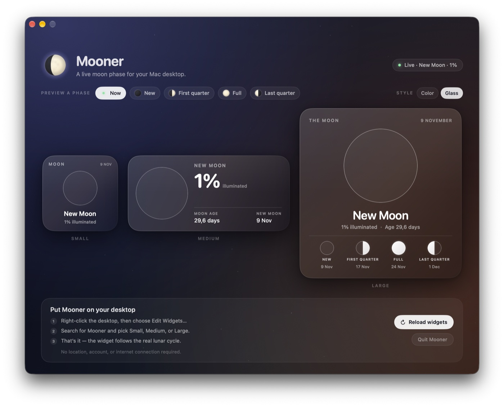
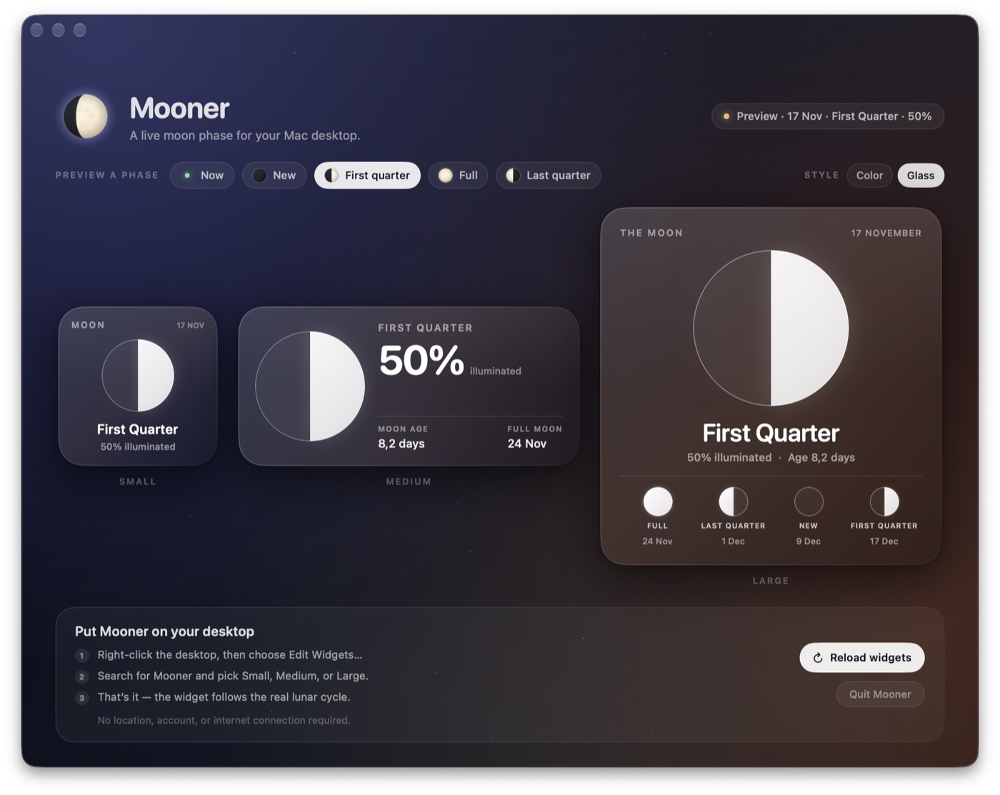

# Mooner

Виджет текущей фазы Луны для рабочего стола macOS. Три размера, без интернета и геолокации.


## Что умеет

- Показывает **настоящую текущую фазу** — положение Луны считается локально по формулам Жана Мёза (Meeus, *Astronomical Algorithms*).
- Три размера: **Small**, **Medium**, **Large**. В большом виджете — ближайшие четыре главные фазы с датами.
- Обновляется по таймлайну WidgetKit каждый час на двое суток вперёд; фаза, возраст и освещённость пересчитываются для каждого момента.
- Не требует сети, аккаунта или доступа к геолокации.
- Умеет выглядеть уместно и в цвете, и в системном «стеклянном» режиме macOS.

## Стеклянный режим macOS

В macOS 26/27 виджеты на рабочем столе автоматически становятся монохромными, когда активно другое приложение
(настройка **System Settings → Desktop & Dock → Widgets → Dim widgets on desktop**). В этом режиме система
убирает цветной фон и тонирует содержимое виджета.

Mooner это учитывает: при `widgetRenderingMode == .accented` Луна превращается в белую фазовую графику на
системном стекле — новая Луна читается как контур диска, полная — как залитый белый круг.

Если хочется всегда видеть цветную звёздную версию (это глобальные настройки macOS, они влияют на все виджеты):

- **System Settings → Appearance → Icon & widget style → Default**
- **System Settings → Desktop & Dock → Widgets → Dim widgets on desktop → Never**

В приложении Mooner есть переключатель **Style → Color / Glass**, чтобы посмотреть оба варианта заранее.





## Установка

1. Соберите приложение в Xcode (схема `Mooner`, macOS 15+) или из терминала:

   ```sh
   xcodebuild -project Mooner.xcodeproj -scheme Mooner \
     -configuration Release -derivedDataPath .build/dd \
     -destination 'platform=macOS' build
   ```

2. Скопируйте `Mooner.app` в `/Applications` и запустите один раз:

   ```sh
   cp -R .build/dd/Build/Products/Release/Mooner.app /Applications/
   open /Applications/Mooner.app
   ```

3. Добавьте виджет: правый клик по рабочему столу → **Edit Widgets…** → **Mooner** → нужный размер.
   Или через **Notification Center → Edit Widgets**.

Приложение можно закрыть — виджет продолжит жить на рабочем столе.

## Разработка

Проект сгенерирован через [XcodeGen](https://github.com/yonaskolb/XcodeGen):

```sh
brew install xcodegen
xcodegen generate
open Mooner.xcodeproj
```

Структура:

```
Mooner/             — приложение-хост с превью всех трёх размеров
MoonerWidget/       — WidgetKit-расширение (TimelineProvider + WidgetBundle)
Shared/Astronomy.swift        — фаза, освещённость, возраст, даты событий
Shared/MoonVisuals.swift      — отрисовка Луны, фазовый shape, фон, звёзды
Shared/MoonWidgetContent.swift — layout Small / Medium / Large
```

Астрономия проверена по эфемеридам (расхождение моментов новолуния/полнолуния — единицы минут,
освещённость — доли процента).

## Приватность

Mooner не делает сетевых запросов и не запрашивает данные о местоположении. Всё считается на устройстве.
