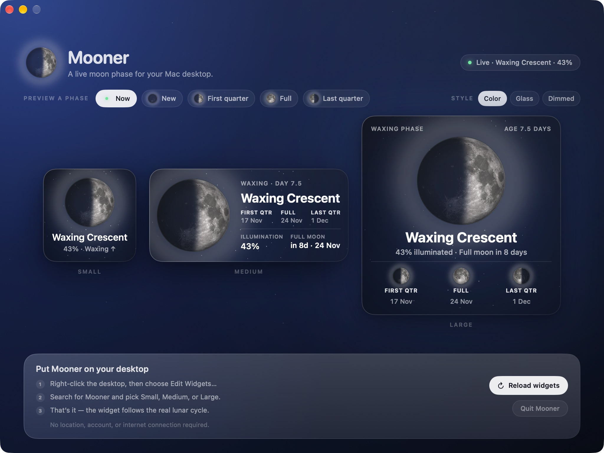
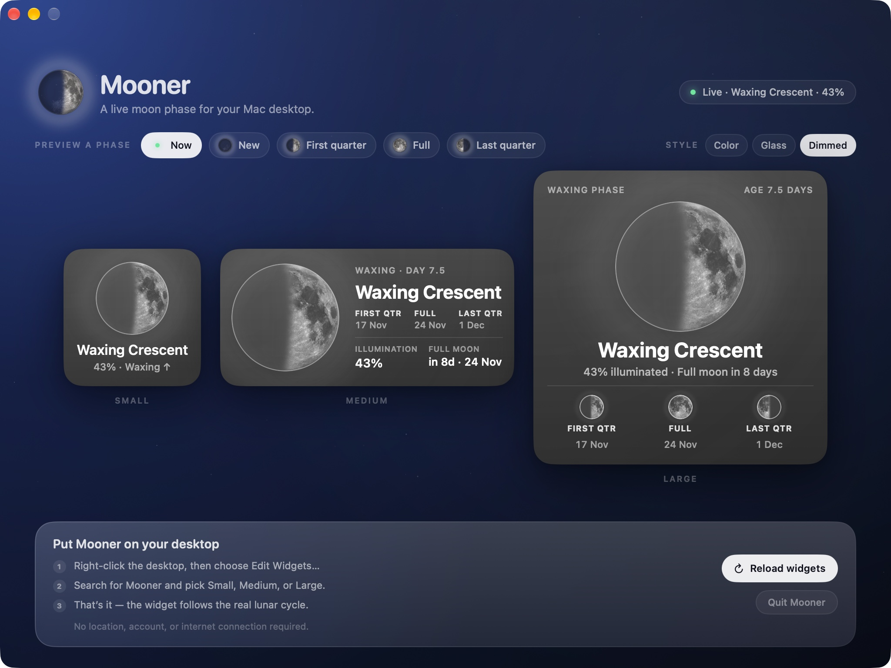

# Mooner

A live moon phase widget for your Mac desktop. Three sizes, no internet, no location access.


## Features

- **The real current phase** — computed locally with Jean Meeus' formulas
  (*Astronomical Algorithms*), accurate to a fraction of a percent.
- **Three widget sizes** — Small, Medium, Large. Medium and Large include the
  upcoming principal phases with dates; Large adds mini phase discs.
- **Honest timeline** — WidgetKit entries every hour for two days ahead, plus
  entries at the exact moments of new moon, quarters and full moon, so names,
  ages and trends flip on time.
- **Three looks** — Color (deep space), Glass (studio frosted material) and
  Dimmed (the monochrome appearance macOS uses on the desktop). The app
  previews all three: **Style → Color / Glass / Dimmed**.
- **Dimmed-aware rendering** — in the system clear/tinted mode dark pixels
  become alpha, so the lit side stays solid and textured while the unlit side
  is a soft outlined disc: a new moon never reads as a full moon.
- **Live app icon** — the Dock / Cmd-Tab tile shows the *current* phase,
  redrawn at launch, every 30 minutes and after wake. The bundle icon is a
  timeless full moon.
- **Private by design** — no network requests, no account, no location.

## Requirements

- macOS 15 or later
- Xcode 16 or later (command line tools included)
- [XcodeGen](https://github.com/yonaskolb/XcodeGen) (`brew install xcodegen`)

## Build & install

```sh
xcodegen generate
xcodebuild -project Mooner.xcodeproj -scheme Mooner \
  -configuration Release -derivedDataPath .build/dd-release \
  -destination 'platform=macOS' build
cp -R .build/dd-release/Build/Products/Release/Mooner.app /Applications/
open /Applications/Mooner.app
```

Signing: the project ships without a development team. In Xcode, pick your
own team under *Signing & Capabilities*, or pass one on the command line:
`xcodebuild … DEVELOPMENT_TEAM=<your team id>`. For a compile-only check
(CI-style) add `CODE_SIGNING_ALLOWED=NO`.

Then add the widget: right-click the desktop → **Edit Widgets…** → search
**Mooner** → pick Small, Medium or Large. The app can be quit afterwards —
the widget keeps living on the desktop.

## Appearance on the desktop

macOS 26/27 dims desktop widgets to monochrome while another app is active
(*System Settings → Desktop & Dock → Widgets → Dim widgets on desktop*).
Mooner renders specifically for that mode (see above). To always see the
color version, set:

- *System Settings → Appearance → Icon & widget style → Default*
- *System Settings → Desktop & Dock → Widgets → Dim widgets on desktop → Never*

| Color | Dimmed |
| --- | --- |
|  |  |

## Preview flags

The host app accepts launch arguments for screenshots and QA:

```sh
open Mooner.app --args --preview-phase=firstQuarter --preview-style=glass
```

- `--preview-phase=` `now` (default), `newMoon`, `firstQuarter`, `fullMoon`, `lastQuarter`
- `--preview-style=` `glass` (default), `color`, `dimmed`
- `--preview-dimmed` — shortcut for the dimmed style

## Development

```sh
brew install xcodegen
xcodegen generate
open Mooner.xcodeproj
```

The Xcode project is generated — after adding or removing files, run
`xcodegen generate` again and commit the updated `project.pbxproj`.

```
Mooner/                        — host app with previews of all three sizes
Mooner/LiveAppIcon.swift       — live phase on the Dock / Cmd-Tab tile
MoonerWidget/                  — WidgetKit extension (TimelineProvider + bundle)
Shared/Astronomy.swift         — phase, illumination, age, event dates (Meeus)
Shared/MoonFormatting.swift    — English numbers/dates, full-moon countdown
Shared/MoonPhaseView.swift     — textured sphere, phase mask, earthshine, limb darkening
Shared/MoonVisuals.swift       — phase shape, backgrounds, stars, glass material
Shared/MoonWidgetContent.swift — Small / Medium / Large layouts
Shared/MoonAppIcon.swift       — app icon artwork (squircle, space, moon)
Shared/Assets.xcassets         — lunar texture (CC BY-SA 3.0, see LICENSE-ASSETS)
Tools/render-icon.swift        — CLI that regenerates the icon PNGs
```

Regenerate the static icon PNGs (phase argument optional, defaults to full moon):

```sh
swiftc -O Tools/render-icon.swift Shared/MoonVisuals.swift \
  Shared/MoonPhaseView.swift Shared/MoonAppIcon.swift \
  -o .build/iconrender -framework AppKit -framework SwiftUI -framework WidgetKit
.build/iconrender Mooner/Assets.xcassets/AppIcon.appiconset 0.5
```

Astronomy is verified against ephemerides: new/full moon moments within a few
minutes, illumination within fractions of a percent.

## Privacy

Mooner makes no network requests and never asks for your location.
Everything is computed on device.

## License

- Code: [MIT](LICENSE)
- Lunar texture and icon artwork embedding it: [CC BY-SA 3.0](LICENSE-ASSETS)

## Credits

Lunar texture: [FullMoon2010.jpg](https://commons.wikimedia.org/wiki/File:FullMoon2010.jpg)
by Gregory H. Revera, licensed under
[CC BY-SA 3.0](https://creativecommons.org/licenses/by-sa/3.0/).
Cropped and resized for the widget.
